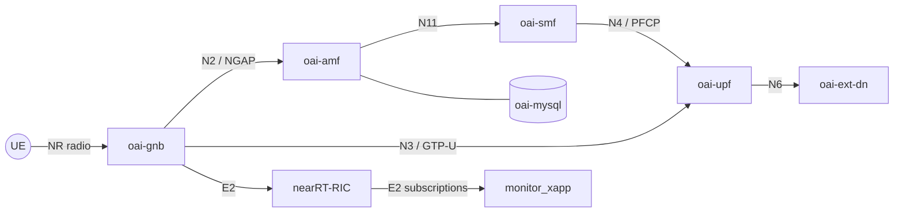
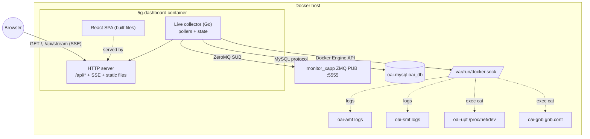
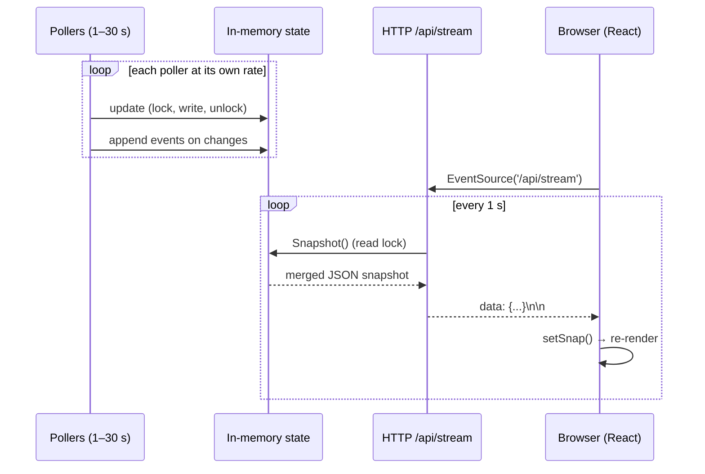

# 1. Architecture overview

## 1.1 Goals

The dashboard answers four operational questions about a 5G standalone (SA) network:

1. **Who is on the network?** Subscribers provisioned, UEs registered, UEs actively exchanging data, their IP addresses and sessions.
2. **How much traffic is flowing and how well?** Uplink/downlink throughput, packet rates, packet loss, radio block error rate.
3. **Is the core healthy?** Status, health checks, uptime, CPU and memory of each network function (NF).
4. **How is the radio configured?** gNB identity, cell parameters, frequency, bandwidth, TDD frame structure.

It also offers a small set of **management actions** (restart an NF, add/remove a subscriber), disabled by default.

Design constraints that shaped the implementation:

- **Zero modification of the monitored network.** The OAI containers are not reconfigured, patched or restarted. Everything is observed from the outside.
- **Single deployable.** One container image, one port.
- **Honest data.** If a value is estimated or stale, the UI says so instead of presenting it as a measurement.

## 1.2 The monitored testbed

The platform was built against this OAI deployment (container names and addresses are the defaults it expects; all are configurable):

| Container | Image | Role | Networks |
|-----------|-------|------|----------|
| `oai-amf` | `oai-amf:v2.1.10` | Access & Mobility Management Function | `oai-public-net` 192.168.71.132 |
| `oai-smf` | `oai-smf:v2.1.10` | Session Management Function | `oai-public-net` 192.168.71.133 |
| `oai-upf` | `oai-upf:v2.1.10` | User Plane Function | `oai-public-net` .134, `oai-traffic-net` 192.168.72.134 |
| `oai-mysql` | `mysql:8.0` | Subscriber DB (acts as UDR storage) | `oai-public-net` .131 |
| `oai-ext-dn` | `trf-gen-cn5g` | External data network (iperf3 server, NAT to Internet) | `oai-traffic-net` .135 |
| `oai-gnb` | `oai-gnb-cuda` | gNB (`nr-softmodem`) with a USRP radio | `oai-public-net` .140, `oai-e2-net` 192.168.73.140 |
| `nearRT-RIC` | `oai-flexric` | FlexRIC near-real-time RIC | `oai-e2-net` .154 |
| `monitor_xapp` | `oai-flexric` | Python xApp publishing MAC stats over ZeroMQ :5555 | `oai-e2-net` .155 |

This is a **minimal OAI core**: AMF, SMF and UPF, with the AMF reading authentication data straight from MySQL. There is no separate NRF, AUSF, UDM or UDR container. The dashboard discovers whichever NFs exist, so a full core shows up automatically (see [03 § Docker](03-data-collection.md#1-docker-engine-api-nf-health)).



## 1.3 The platform



### Components

| Component | Tech | Responsibility |
|-----------|------|----------------|
| **Live collector** | Go goroutines | Polls each data source at its own rate, keeps the latest state in memory, detects changes and emits events |
| **Mock source** | Go | Synthetic network with 72 UEs, for demos without OAI |
| **HTTP server** | Go `net/http` | REST endpoints, a Server-Sent Events stream, management endpoints, static file serving for the SPA |
| **Frontend** | React 18, Vite, Recharts, lucide-react | Renders the snapshot. Six views: Overview, Subscribers & UEs, Traffic Analytics, 5G Core, RAN & gNB, Settings |

Both live and mock sources implement the same Go interface (`Source`), so the HTTP layer and the frontend don't know or care which one is active.

## 1.4 End-to-end data flow



Key points:

- **Collection is decoupled from delivery.** Pollers write into shared state at their own rate (UPF every 1 s, AMF/SMF every 3 s, containers every 5 s, and so on). The snapshot is computed on demand by merging the latest state of every source.
- **One snapshot per second per browser.** Each connected browser gets its own SSE stream. A snapshot is a few kilobytes plus up to 180 traffic points.
- **Longer history is fetched separately.** The Traffic Analytics view fetches `/api/traffic/history?seconds=N` (up to 3600 s) every 2 s instead of bloating every snapshot.

## 1.5 Repository layout

```
5gdashboard-demo/
├── backend/                Go module (github.com/local/5gdashboard)
│   ├── main.go             config from env, HTTP routes, SSE, management endpoints, static SPA
│   ├── model.go            JSON data model (Snapshot, UE, NF, GNB, …)
│   ├── collector.go        Live source: pollers, state, correlation, snapshot building
│   ├── parsers.go          AMF table parser, SMF log tracker, /proc/net/dev, gnb.conf
│   ├── docker.go           Minimal Docker Engine API client over the unix socket
│   ├── xapp.go             ZeroMQ subscriber for the FlexRIC monitor xApp
│   ├── subscribers.go      MySQL access to oai_db (list / add / delete)
│   └── mock.go             Synthetic data source
├── frontend/               React + Vite app
│   ├── index.html
│   ├── vite.config.js      dev server proxying /api → :8080
│   └── src/
│       ├── main.jsx, App.jsx    entry, layout, routing, KPI row
│       ├── api.js               useSnapshot (SSE), useFetch, api()
│       ├── format.js            bytes/rate/time formatting
│       ├── styles.css           design tokens and all styling
│       ├── components/common.jsx shared widgets and charts
│       └── pages/               Overview, Subscribers, Traffic, Core, Ran, Settings
├── docs/                   this documentation
├── Dockerfile              multi-stage: node build → go build → alpine runtime
├── docker-compose.yml      deployment next to the OAI stack
├── design.png              original UI design
└── README.md
```
