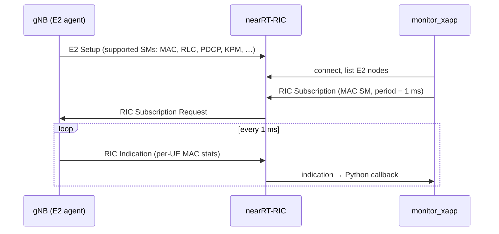

# 2. 5G & O-RAN concepts

This chapter explains every technical term the dashboard displays. It's written for readers who know networking but not necessarily 3GPP. Each concept ends with **"In the dashboard"**: where the value appears and where it comes from.

---

## 2.1 The 5G system in one picture

A 5G standalone (SA) network has three parts:

```
 UE  ──radio──  RAN (gNB)  ──N2 (control) / N3 (user data)──  5G Core  ──N6──  Data Network (Internet)
```

- **UE (User Equipment):** the phone, modem or test device.
- **RAN (Radio Access Network):** the base station, called a **gNB** in 5G. It handles the radio: scheduling, modulation and retransmissions.
- **5G Core (5GC):** a set of software **Network Functions (NFs)** that talk over HTTP/2 APIs (the *Service-Based Architecture*). The NFs that matter here:

| NF | Full name | What it does |
|----|-----------|--------------|
| **AMF** | Access & Mobility Management Function | Entry point for control signalling from the gNB (N2/NGAP). Handles UE registration, authentication orchestration, mobility, and keeps the per-UE context |
| **SMF** | Session Management Function | Creates and manages **PDU sessions**: allocates the UE IP address and programs the UPF over N4/PFCP |
| **UPF** | User Plane Function | Forwards the actual user packets between the gNB (N3, GTP-U tunnels) and the data network (N6). The only NF that sees user traffic |
| **AUSF / UDM / UDR** | Authentication Server, Unified Data Management, Unified Data Repository | Authenticate subscribers and store subscription data. In the OAI minimal deployment these are replaced by the AMF reading MySQL directly |
| **NRF** | NF Repository Function | Service discovery between NFs (not deployed in the minimal setup) |
| **PCF / NSSF** | Policy Control / Network Slice Selection | Policies and slice selection (optional) |

**Reference points** (the "N" interfaces):

| Interface | Between | Protocol | Carries |
|-----------|---------|----------|---------|
| N1 | UE ↔ AMF | NAS (tunnelled through the gNB) | Registration, session requests |
| N2 | gNB ↔ AMF | NGAP over SCTP | UE context, handover, paging |
| N3 | gNB ↔ UPF | GTP-U over UDP | User packets in tunnels |
| N4 | SMF ↔ UPF | PFCP over UDP | Forwarding rules (PDRs, FARs, QERs) |
| N6 | UPF ↔ Data Network | Plain IP | Decapsulated user traffic |

**In the dashboard:** the *5G Core* view and the *5G Core Health* card list every NF container found, with status, health check, uptime, CPU and memory.

---

## 2.2 Subscriber and UE identities

### SUPI / IMSI
The **SUPI** (Subscription Permanent Identifier) is the permanent identity of a subscriber. In practice it's an **IMSI** of 15 digits:

```
262 99 0100016069
│   │  └─ MSIN: subscriber number within the operator
│   └──── MNC: Mobile Network Code (2 or 3 digits)   → 99
└──────── MCC: Mobile Country Code                   → 262
```

The **PLMN** (Public Land Mobile Network) identifier is MCC+MNC, written `262,99` or `262-99`. The SMF logs prefix the IMSI as `imsi-262990100016069`.

### 5G-GUTI
A **temporary** identity assigned by the AMF after registration, so the IMSI isn't sent over the air repeatedly. It contains the PLMN, the AMF identity (GUAMI) and a 5G-TMSI. Example from the AMF table: `26299010041348713076`.

### NGAP UE IDs
When a UE is attached to a gNB, the N2 signalling about it is identified by two numbers:
- **RAN UE NGAP ID:** chosen by the gNB.
- **AMF UE NGAP ID:** chosen by the AMF.

They identify the UE's *signalling association*, not the subscriber. They change on every new connection.

### C-RNTI
The **Cell Radio Network Temporary Identifier** is a 16-bit value the gNB assigns to a connected UE inside one cell. The MAC scheduler uses it to address the UE on the radio. The FlexRIC statistics are keyed by RNTI (e.g. `0xb350`).

> **Why this matters for correlation:** the core knows UEs by IMSI and NGAP IDs; the radio statistics know UEs by RNTI. No log the dashboard reads maps one to the other directly. See [04 § UE correlation](04-correlation.md#41-building-the-ue-list).

**In the dashboard:** *Subscribers & UEs* → UE details panel shows IMSI, NGAP IDs, C-RNTI.

---

## 2.3 Registration state (5GMM) and connection state (CM)

3GPP defines two independent state machines per UE in the AMF:

| State machine | States | Meaning |
|---------------|--------|---------|
| **5GMM** (5G Mobility Management) | `5GMM-DEREGISTERED`, `5GMM-REGISTERED` (plus transient `-INITIATED` states) | Is the UE registered on the network (authenticated, has a context)? |
| **CM** (Connection Management) | `CM-IDLE`, `CM-CONNECTED` | Does the UE currently have an active signalling connection (an RRC connection to the gNB and an N2 association)? |

A UE can be *registered but idle*: it's known to the network and can be paged, but its radio is asleep. The OAI AMF prints only the 5GMM state in its periodic table.

**In the dashboard:**
- `state` = the raw 5GMM state from the AMF.
- `status` (Active / Idle / Deregistered) is *derived* by the dashboard by combining 5GMM state, radio statistics and traffic. See [04 § UE status](04-correlation.md#42-ue-status).
- **Registered UEs** KPI = UEs in `5GMM-REGISTERED`.
- **Active UEs** KPI = registered UEs that currently show radio activity or traffic.

---

## 2.4 PDU sessions, DNN and UE IP addresses

A **PDU session** is a data connection between the UE and a data network, roughly what "mobile data on" means. Setting one up:

1. The UE sends a *PDU Session Establishment Request* (NAS, via the AMF).
2. The AMF asks the SMF to create an *SM context* (`Create SM Context Request`).
3. The SMF allocates an IP address. This is the **PAA** (PDU Address Allocation).
4. The SMF programs the UPF over PFCP, and the gNB sets up the radio bearer and GTP-U tunnel.

Key attributes:

- **DNN (Data Network Name):** the 5G equivalent of an APN. It names which network the session connects to. In this testbed the DNN is `oai` with the pool `12.1.1.0/24`, so the UE got `12.1.1.233`.
- **PDU session type:** IPv4, IPv6, IPv4v6 or Ethernet.
- **5QI:** the QoS class of the default flow (9 = best-effort internet).

**In the dashboard:** UE `IP` and `DNN` columns, the **PDU sessions** count, and "PDU session established" events. All are taken from the SMF logs.

---

## 2.5 Network slicing: S-NSSAI, SST, SD

A **network slice** is a logical end-to-end network with its own characteristics. It's identified by an **S-NSSAI** (Single Network Slice Selection Assistance Information):

- **SST (Slice/Service Type):** standard values are **1 = eMBB** (enhanced Mobile Broadband), **2 = URLLC** (Ultra-Reliable Low-Latency Communications), **3 = MIoT/mMTC** (massive IoT).
- **SD (Slice Differentiator):** optional 24-bit value to tell slices of the same type apart. `0xFFFFFF` means "no SD".

The testbed gNB advertises `sst = 1, sd = 0xffffff`: a single eMBB slice.

**In the dashboard:** the *Traffic Distribution* donut groups traffic volume by slice name (derived from SST). With one slice, it shows 100% eMBB once traffic flows.

---

## 2.6 Cell identity and configuration

| Parameter | Meaning | Testbed value |
|-----------|---------|---------------|
| **gNB ID** | Identifier of the base station inside the PLMN | `0xe00` |
| **NR Cell Identity (NCI)** | 36-bit cell identifier (gNB ID + local cell ID) | `nr_cellid = 12345678` |
| **PCI** (Physical Cell ID) | 0–1007, encoded in the synchronisation signals; lets UEs tell neighbouring cells apart | `0` |
| **TAC** (Tracking Area Code) | Groups cells for paging and registration | `1` |
| **SSB** | Synchronisation Signal Block: what the UE detects first when it searches for a cell | |
| **SSB block power** | Transmit power of the SSB (dBm per resource element in OAI's config) | `-25` |
| **PRACH configuration index** | Selects when and how UEs may send random-access preambles | `98` |

**In the dashboard:** *RAN & gNB* view and the *gNB Cells* card. These values are parsed from `gnb.conf`.

---

## 2.7 Frequencies: bands and NR-ARFCN

5G carrier frequencies are encoded as an integer called the **NR-ARFCN** (TS 38.104 §5.4.2.1):

```
F (MHz) = F_REF-Offs + ΔF_Global × (N − N_REF-Offs)
```

| N range | ΔF_Global | F_REF-Offs | N_REF-Offs |
|---------|-----------|------------|------------|
| 0 – 599 999 | 5 kHz | 0 MHz | 0 |
| 600 000 – 2 016 666 | 15 kHz | 3000 MHz | 600 000 |
| 2 016 667 – 3 279 165 | 60 kHz | 24 250.08 MHz | 2 016 667 |

Example from the testbed: `absoluteFrequencySSB = 640320`. This falls in the second range, so F = 3000 + 0.015 × (640320 − 600000) = **3604.8 MHz**.

- **absoluteFrequencySSB:** where the SSB sits.
- **dl_absoluteFrequencyPointA:** **Point A**, the common reference at the bottom of the resource grid (`640032` → 3600.48 MHz).
- **Band n78:** 3300–3800 MHz, TDD. The most common 5G mid-band ("C-band").

**In the dashboard:** "Band n78 (3.60 GHz)" and "SSB frequency 3604.8 MHz". The backend converts the ARFCN with the formula above (`nrarfcnToMHz` in `parsers.go`).

---

## 2.8 Numerology, subcarrier spacing, slots, PRBs and bandwidth

NR uses OFDM with a flexible **subcarrier spacing (SCS)** defined by the **numerology µ**:

| µ | SCS | Slot duration | Slots per 1 ms subframe |
|---|-----|---------------|-------------------------|
| 0 | 15 kHz | 1 ms | 1 |
| 1 | 30 kHz | 0.5 ms | 2 |
| 2 | 60 kHz | 0.25 ms | 4 |
| 3 | 120 kHz | 0.125 ms | 8 |

A **slot** has 14 OFDM symbols. A **PRB (Physical Resource Block)** is 12 consecutive subcarriers. It's the frequency unit the scheduler hands out. A UE's share of the cell is "how many PRBs, in how many slots".

The **carrier bandwidth** is configured as a number of PRBs (`dl_carrierBandwidth`). It maps to a channel bandwidth through TS 38.101-1 Table 5.3.2-1. For example, at 30 kHz SCS: 24 PRB = 10 MHz, 51 = 20 MHz, 106 = 40 MHz, 273 = 100 MHz.

Testbed: `dl_subcarrierSpacing = 1` (µ = 1 → 30 kHz) and `dl_carrierBandwidth = 24`, which gives **10 MHz**.

**In the dashboard:** "Bandwidth 10 MHz (24 PRB)", "Subcarrier spacing 30 kHz", "Numerology µ 1". The per-UE PRB columns come from the RIC (see [§ 2.11](#211-o-ran-near-rt-ric-e2-and-xapps)).

---

## 2.9 TDD frame structure

In **TDD** (Time Division Duplex) the same frequency carries downlink and uplink at different times. OAI configures the pattern with:

- `dl_UL_TransmissionPeriodicity`: an index into {0.5, 0.625, 1, 1.25, 2, 2.5, **5**, 10} ms. `6` → 5 ms.
- `nrofDownlinkSlots` = 7, `nrofUplinkSlots` = 2.
- The remaining slots are **special (S)** slots that contain DL symbols, a guard period and UL symbols.

At µ = 1 there are 2 slots/ms, so a 5 ms period has 10 slots: **`D D D D D D D S U U`**. The downlink therefore gets roughly 75% of the air time, which is why DL throughput is normally much higher than UL on this kind of cell.

**In the dashboard:** the *Frame Structure* card on *RAN & gNB* draws this pattern and the DL ratio. The special slot counts as half DL in that ratio.

---

## 2.10 Link quality: MCS, BLER, HARQ and link adaptation

These are the radio metrics the dashboard gets from the RIC.

### MCS (Modulation and Coding Scheme)
An index (0–28 for the 64-QAM table, 0–27 for the 256-QAM table) that selects the **modulation** (QPSK, 16-QAM, 64-QAM, 256-QAM) and the **code rate** for a transmission. A higher MCS carries more bits per PRB but needs a cleaner channel. MCS is chosen per UE by the gNB scheduler for every transmission. The dashboard shows the value reported for the latest scheduled transmission (`dl_mcs1` / `ul_mcs1`).

### HARQ (Hybrid Automatic Repeat reQuest)
Every transport block (TB) the gNB sends is checked by the receiver with a CRC. The receiver answers **ACK** (decoded) or **NACK** (failed). On NACK, the sender retransmits, possibly with different redundancy bits, and the receiver soft-combines the attempts. OAI allows up to 4 transmission rounds by default.

### BLER (Block Error Rate)
**BLER = failed transport blocks ÷ transmitted transport blocks.** In practice it's measured on *first* transmissions: the share of new TBs that come back NACK and need a HARQ retransmission.

- **DL BLER:** measured from the HARQ ACK/NACK feedback the UE sends for downlink TBs.
- **UL BLER:** measured by the gNB itself from CRC results of the UL TBs (PUSCH) it receives.

The OAI gNB MAC keeps a **smoothed BLER estimate per UE and direction** and uses it for **link adaptation**. If BLER rises above an upper target, the scheduler lowers the MCS (more robust). If BLER drops below a lower target, it raises the MCS (more throughput). The targets are configurable in OAI (`dl_bler_target_upper/lower`, `ul_bler_target_upper/lower` in the `MACRLCs` section, defaults around 5–15%). So **a well-behaved link sits roughly in the 5–10% BLER range by design**. 0% is not the goal, because it means the MCS is too conservative.

How to read it:

| Observation | Likely meaning |
|-------------|----------------|
| BLER ≈ target, MCS high | Good channel, link adaptation working |
| BLER ≈ target, MCS low | Poor channel (distance, interference, low SNR), but the link is stable |
| BLER persistently ≫ target (e.g. > 30%) | Link adaptation can't keep up, or the UE has lost the radio link |
| MCS 0 and no PRBs | UE not being scheduled (idle, or stale statistics) |

The dashboard colours BLER green (≤ 3%), orange (3–10%) or red (> 10%).

**In the dashboard:** *RAN & gNB → UE Radio Metrics*, the *UE details* panel, and "avg BLER" on *Traffic Analytics*. How the numbers travel from the scheduler to the browser is explained in [03 § FlexRIC xApp](03-data-collection.md#6-flexric-monitor-xapp-mcs-bler-prbs).

---

## 2.11 O-RAN: near-RT RIC, E2 and xApps

**O-RAN** opens up the RAN so that third-party software can monitor and control it. The relevant pieces:

- **Near-Real-Time RIC (RAN Intelligent Controller):** a platform that runs control and monitoring loops on a 10 ms – 1 s timescale. The testbed uses **FlexRIC** (Eurecom/Mosaic5G), container `nearRT-RIC`.
- **E2 interface:** connects the RIC to **E2 nodes** (here the OAI gNB, which embeds an E2 agent). It has two layers:
  - **E2AP** (Application Protocol): setup, *subscriptions*, *indications* (reports), *control* messages.
  - **E2SM** (Service Models): define *what* is reported or controlled. Standard ones include **KPM** (KPI monitoring) and **RC** (RAN control). FlexRIC adds its own lightweight SMs for **MAC**, **RLC**, **PDCP**, **GTP** and **SLICE** statistics.
- **xApp:** an application on top of the RIC. It subscribes to service models and receives indications. Here, `monitor_xapp` subscribes to the **MAC service model** with a **1 ms reporting period**.



The MAC SM indication carries one record per connected UE. It includes the RNTI, `dl_bler`, `ul_bler`, `dl_mcs1`, `ul_mcs1`, the PRBs scheduled in this slot (`dl_sched_rb`, `ul_sched_rb`), cumulative PRB counters (`dl_aggr_prb`, `ul_aggr_prb`), and more (TBS counters, CQI, SNR, PHR, BSR) that this xApp doesn't forward today.

**In the dashboard:** RIC and xApp containers appear under *RAN & RIC Components*. The MAC statistics populate the radio columns. The *Settings* view shows whether the xApp feed is `ok` or `stale`.

---

## 2.12 User-plane counters: throughput, packet rate, loss

- **Throughput (Mbps):** bits per second through the UPF. **Downlink (DL)** = towards the UE; **uplink (UL)** = from the UE.
- **Packet rate (pps):** packets per second per direction.
- **Packet loss (%):** packets dropped (or received with errors) at the UPF interfaces, as a share of all packets in the interval. This is *user-plane* loss at the core. It's not the same as radio BLER: radio errors are mostly hidden by HARQ and RLC retransmissions before packets reach the UPF.

**In the dashboard:** KPI cards, *Network Traffic*, *Traffic Analytics*. See [03 § UPF](03-data-collection.md#4-upf-tunnel-interface-throughput-packet-rate-loss) for the exact computation.

---

## 2.13 Glossary

| Term | Meaning |
|------|---------|
| 5GC | 5G Core network |
| 5GMM | 5G Mobility Management (registration state) |
| 5QI | 5G QoS Identifier |
| AMF / SMF / UPF | See § 2.1 |
| ARFCN | Absolute Radio Frequency Channel Number |
| BLER | Block Error Rate |
| CM | Connection Management (IDLE / CONNECTED) |
| C-RNTI | Cell Radio Network Temporary Identifier |
| DNN | Data Network Name |
| E2 / E2AP / E2SM | O-RAN RIC interface / application protocol / service model |
| eMBB / URLLC / mMTC | Slice types (SST 1 / 2 / 3) |
| GTP-U | GPRS Tunnelling Protocol, user plane (N3) |
| GUTI | Globally Unique Temporary Identifier |
| HARQ | Hybrid ARQ, fast MAC-layer retransmission |
| IMSI / SUPI | Permanent subscriber identity |
| MCS | Modulation and Coding Scheme |
| NGAP | NG Application Protocol (N2) |
| NR | New Radio (5G air interface) |
| PAA | PDU Address Allocation (UE IP) |
| PCI | Physical Cell Identity |
| PDU session | Data session between UE and a DN |
| PFCP | Packet Forwarding Control Protocol (N4) |
| PLMN | Public Land Mobile Network (MCC+MNC) |
| PRB | Physical Resource Block (12 subcarriers) |
| RIC | RAN Intelligent Controller |
| S-NSSAI / SST / SD | Slice identifier / type / differentiator |
| SCS | Subcarrier spacing |
| SSB | Synchronisation Signal Block |
| TAC | Tracking Area Code |
| TB | Transport Block (MAC data unit) |
| TDD | Time Division Duplex |
| UDR | Unified Data Repository |
| xApp | Application on the near-RT RIC |
