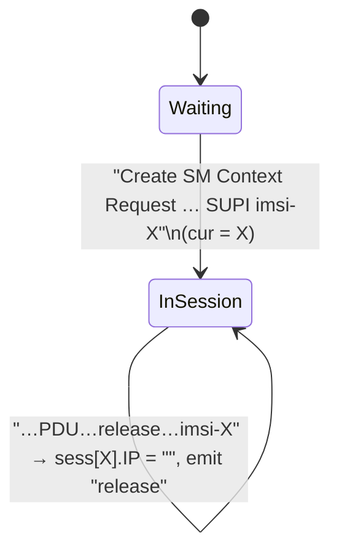
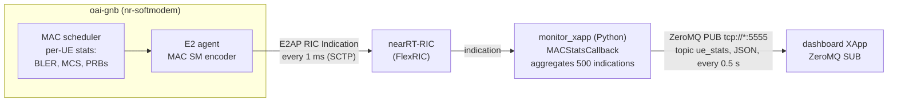

# 3. Data collection in depth

The live collector (`backend/collector.go`, type `Live`) gathers data from **seven sources**. None of them needed changes to the OAI network. This chapter covers each source in turn: what it is, how the dashboard reads it, what the raw data looks like, how it's parsed, how often it runs and what can go wrong.

## Summary

| # | Source | Access method | Poll period | Code | Feeds |
|---|--------|---------------|-------------|------|-------|
| 1 | Docker Engine API | HTTP over `/var/run/docker.sock` | 5 s | `pollContainers` | NF list, status, health, uptime, CPU, memory, IPs |
| 2 | AMF logs | Docker `logs` API (last 400 lines) | 3 s | `pollAMF`, `parseAMF` | Registered UEs, 5GMM state, cell, NGAP IDs, connected gNBs |
| 3 | SMF logs | Docker `logs` API (incremental) | 3 s | `pollSMF`, `smfTracker` | PDU sessions, UE IP, DNN, slice |
| 4 | UPF `/proc/net/dev` | Docker `exec cat` | 1 s | `pollUPF`, `parseNetDev` | Throughput, packet rate, loss, volume |
| 5 | gNB `gnb.conf` | Docker `exec cat` | 30 s | `pollGNBConf`, `parseGNBConf` | Cell configuration |
| 6 | FlexRIC monitor xApp | ZeroMQ SUB | push (~2 Hz) | `XApp.Run` | Per-UE MCS, BLER, PRBs, RNTI |
| 7 | UDR MySQL (optional) | MySQL protocol | 15 s + on demand | `pollSubscribers`, `SubscriberDB` | Subscriber list and count |

Each poller runs in its own goroutine. Each call gets a context timeout of 3 × its period, so a hung Docker call can't pile up. Every source writes its health to `sources[name]` (`"ok"` or an error string). That's what the *Settings → Data Sources* view shows.

Why read logs and counters instead of NF APIs? OAI CN5G v2.1 doesn't offer a stable "list all UEs / sessions / throughput" management API. The NF SBI interfaces are 3GPP service APIs meant for other NFs, not for monitoring. The AMF and SMF already print the state we need, and Linux already counts every packet the UPF forwards. Reading those keeps the dashboard non-intrusive and version-tolerant. The trade-offs are listed in [10-limitations.md](10-limitations.md).

---

## 1. Docker Engine API (NF health)

### Access
`backend/docker.go` implements a minimal Docker Engine API client. It's an `http.Client` whose transport dials the unix socket `/var/run/docker.sock` (configurable with `DOCKER_SOCK`). It uses no Docker SDK, which keeps the binary small and dependency-free. API paths are unversioned, so the daemon's default API version is used.

Calls used:

| Call | Endpoint | Purpose |
|------|----------|---------|
| `List` | `GET /containers/json?all=1` | All containers, including stopped ones |
| `Inspect` | `GET /containers/{id}/json` | Run state, `StartedAt`, healthcheck status, TTY flag |
| `Stats` | `GET /containers/{id}/stats?stream=false` | One CPU and memory sample |
| `Logs` | `GET /containers/{id}/logs?stdout=1&stderr=1&timestamps=1&tail=N&since=T` | NF logs |
| `Exec` | `POST /containers/{id}/exec`, then `POST /exec/{id}/start` | Run `cat` inside a container |
| `Restart` | `POST /containers/{id}/restart?t=10` | Management action |

**Stream demultiplexing.** For containers without a TTY, Docker multiplexes stdout and stderr in one stream. Each frame has an 8-byte header: byte 0 is the stream type and bytes 4–7 are the big-endian payload length. `demux()` strips these headers. For TTY containers the stream is raw.

### NF discovery
Every container whose name matches this regular expression is treated as a network component:

```
(?i)(amf|smf|upf|nrf|ausf|udm|udr|pcf|nssf|nef|lmf|mysql|gnb|ric|xapp|ext-dn)
```

The match decides the display name and the **kind**:

| Match | Display name | Kind |
|-------|--------------|------|
| amf, smf, upf, nrf, ausf, udm, udr, pcf, nssf, nef, lmf | upper-cased (AMF, …) | `core` |
| mysql | UDR DB | `db` |
| gnb | gNB | `ran` |
| ric / xapp | Near-RT RIC / Monitor xApp | `ric` |
| ext-dn | Ext-DN | `other` |

The list is sorted by kind (core → db → ran → ric → other), then by name. Adding an NRF, AUSF, UDM or PCF container to the deployment makes it appear automatically.

### Status derivation

```
container not running              → offline
running and healthcheck=unhealthy  → degraded
otherwise                          → online
```

`Health` shows the Docker healthcheck result (`healthy`, `unhealthy`, `starting`). Containers without a healthcheck show their run state (`running`).

### CPU and memory
These use the same formulas as `docker stats`:

```
cpu%   = (Δ container cpu_usage.total_usage / Δ system_cpu_usage) × online_cpus × 100
memory = memory_stats.usage − memory_stats.stats.inactive_file     (page cache excluded)
```

`stream=false` makes Docker take two samples about 1 s apart. To keep the 5 s cycle short, all containers are inspected and sampled **in parallel** (one goroutine each, joined with a `WaitGroup`).

### Events
When a container's status changes between two polls, an event is emitted, for example *"SMF (oai-smf) is now offline"* at level `error`.

### Failure modes
- Socket not mounted, or no permission: `sources.docker = "error: …"`. NFs disappear and the network status becomes `offline`. In `MODE=auto` the backend falls back to mock mode at startup if the socket doesn't exist.

---

## 2. AMF logs (registered UEs and gNBs)

### What the AMF prints
Every 20 seconds OAI AMF v2.x logs two ASCII tables at `info` level:

```
|----------------------------------gNBs' Information-----------------------------------|
|  Index |    Status    |  Global Id  |   gNB Name   |     PLMN     |
|    1   |   Connected  |    0x0E00   |    gNB-oai   |    262,99    |
|---------------------------------------------------------------------------------------|

|----------------------------------UEs' Information------------------------------------------------------------------|
|  Index |   5GMM State    |      IMSI       |         GUTI         | RAN UE NGAP ID | AMF UE NGAP ID |  PLMN  | Cell Id  |
|    1   | 5GMM-REGISTERED | 262990100016069 | 26299010041348713076 |      0x01      |      0x31      | 262,99 | 0000e0000|
|--------------------------------------------------------------------------------------------------------------------|
```

(Abridged. The real tables are padded wider.)

### How the dashboard reads it
`pollAMF` fetches the **last 400 log lines** every 3 s. That always includes at least one complete table pair, even with debug logging enabled. `parseAMF`:

1. Scans the lines **backwards** to find the most recent `UEs' Information` and `gNBs' Information` headers.
2. `tableRows` walks forward from each header. It strips the Docker timestamp prefix (`splitTS`), skips separator lines (`|---`) and the column header (`|  Index`), and stops at the closing separator or a non-table line.
3. Each row is split on `|` and the cells are trimmed. gNB rows need ≥ 5 cells and UE rows ≥ 8 cells.

Result: `[]amfGNB{Status, GlobalID, Name, PLMN}` and `[]amfUE{State, IMSI, GUTI, RANUEID, AMFUEID, PLMN, CellID}`.

An empty UE table is a valid result: zero registered UEs. If no table is found at all, the source reports *"no UE/gNB tables found in recent AMF logs"* and the previous state is kept.

### Change detection → events
The collector remembers the previous state of each IMSI (`prevUEState`) and each gNB (`prevGNB`):

| Change | Event |
|--------|-------|
| New IMSI, or 5GMM state changed | `info` *"UE imsi-… 5gmm-registered (cell …)"* or `warning` *"… deregistered"* |
| IMSI disappeared from the table | `warning` *"UE imsi-… removed from AMF context"* |
| gNB status changed / new gNB | `success` *"gNB … connected to AMF"* or `error` on disconnect |

The first poll after startup only seeds the state, so it doesn't flood the event log.

### Why parse the table instead of the registration messages?
The table is the AMF's **authoritative current view**. It's re-printed every 20 s, so the dashboard converges to the truth even if it missed individual messages or was restarted. Parsing individual NAS procedures would mean rebuilding the AMF's state machine.

**Latency:** UE changes show up within one AMF print interval (≤ 20 s) plus one poll (≤ 3 s).

---

## 3. SMF logs (PDU sessions, UE IP, DNN)

### What the SMF prints
During PDU session establishment, OAI SMF logs (among many debug lines):

```
[smf_app] [info]  Handle a PDU Session Create SM Context Request message from AMF, SUPI imsi-262990100016069, SNSSAI - snssai: …
[smf_app] [debug] Requested DNN: oai
[smf_app] [debug] UE Address Allocation
[smf_app] [info]  PAA, Ipv4 Address: 12.1.1.233
```

### The incremental tracker
SMF logs are large (150 000+ lines in a day at debug level), so they're **followed incrementally** instead of re-read:

- At startup `pollSMF(emit=false)` reads the **whole log once** to rebuild current sessions without emitting historical events.
- Every 3 s after that, it requests logs with `since=<unix seconds of the last processed line>`.
- Because `since` has 1-second resolution, some lines come back twice. Each line carries its RFC 3339 nanosecond Docker timestamp, and the tracker **skips any line whose timestamp is ≤ the last one processed** (`smfTracker.lastTS`). Every line is processed exactly once.

`smfTracker.feed` is a small state machine:



| Regex | Purpose |
|-------|---------|
| `PDU Session Create SM Context Request message from AMF, SUPI imsi-(\d+)` | Start of a session for an IMSI |
| `Requested DNN: (\S+)` | DNN for the current session |
| `SST[:=]\s*(\d+)` | Slice type, best effort |
| `PAA, Ipv4 Address: ([0-9.]+)` | Allocated UE IP |
| `(?i)release.*imsi-(\d+)` (line must also contain `PDU`) | Session release |

The result is `sess map[IMSI]*smfSession{IP, DNN, Slice, Sessions}`. The **latest** allocated IP wins. A UE that re-registers gets a new IP, and that one replaces the old one.

### PDU session count
A session is counted when it has an IP **and** its IMSI is currently in the AMF table. This rules out sessions of UEs that have since left.

### Events
`success` *"PDU session established for imsi-… (IP …, DNN …)"* and `info` *"PDU session released …"*.

---

## 4. UPF tunnel interface (throughput, packet rate, loss)

### Why the UPF tunnel interface
The UPF is the only NF that sees user packets. OAI UPF (in its default "simple switch" mode) decapsulates GTP-U from the gNB and delivers the inner IP packets through a Linux TUN device, **`tun0`**, which owns the UE pool gateway `12.1.1.1/24`. Routing then sends them out on N6 (`eth1`). The reverse happens for downlink. So:

| `tun0` counter | Direction | Why |
|----------------|-----------|-----|
| **RX** (received by the kernel *from* the TUN device) | **Uplink** | The UPF writes decapsulated UE packets into the TUN device |
| **TX** (transmitted by the kernel *to* the TUN device) | **Downlink** | Packets routed towards 12.1.1.0/24 go to the UPF process for GTP encapsulation |

Interface layout inside `oai-upf`:

```
eth0  192.168.71.134  N3 (GTP-U from gNB) + N4 (PFCP)
eth1  192.168.72.134  N6 towards oai-ext-dn
tun0  12.1.1.1/24     UE-side tunnel endpoint
```

### Sampling
Every second, `pollUPF` runs `cat /proc/net/dev` inside the UPF container through Docker exec. `parseNetDev` parses each `iface: rx_bytes rx_packets rx_errs rx_drop … tx_bytes tx_packets tx_errs tx_drop …` line into an `ifCounters` struct.

Each sample is compared with the previous one, using the real elapsed time `dt` rather than an assumed 1 s, because exec latency varies:

```
DL Mbps  = Δ tun0.tx_bytes × 8 / dt / 10⁶
UL Mbps  = Δ tun0.rx_bytes × 8 / dt / 10⁶
DL pps   = Δ tun0.tx_packets / dt
UL pps   = Δ tun0.rx_packets / dt
drops    = Δ (tun0 rx/tx drop + rx/tx errs) + Δ (eth0 rx/tx drop + rx/tx errs)      ← N3 included
loss %   = drops / (Δ DL packets + Δ UL packets + drops) × 100
volumes  = running sums of Δ bytes since backend start
```

- **Counter resets** (UPF container restarted): if a counter goes backwards, the new raw value is used as the delta, so the throughput graph doesn't spike negative.
- The first sample only sets the baseline. Totals therefore count from **when the dashboard started**, not from UPF boot.
- Each computed point `{t, dl, ul, dlPps, ulPps, loss, drops}` is appended to a **ring buffer of 3600 points** (1 hour at 1 Hz). Snapshots carry the last 180 points; `/api/traffic/history` serves up to 3600.
- If exec fails, a zero point is still appended so the time axis stays continuous, and `sources.upf` shows the error.

### What "packet loss" means here
It counts packets the **kernel** dropped or flagged as errors on the UPF's tunnel and N3 interfaces: queue overflows, malformed packets, and so on. It doesn't count:
- Losses inside the UPF process (e.g. no matching PDR),
- Radio losses (shown as BLER, and mostly recovered by HARQ/RLC),
- Losses in the external data network.

It's a useful **core-side health indicator**, not an end-to-end loss measurement. For end-to-end loss, run `iperf3 -u` against `oai-ext-dn`, which runs an iperf3 server.

Interface names are configurable with `UPF_TUN_IFACE` (default `tun0`) and `UPF_N3_IFACE` (default `eth0`).

---

## 5. gNB configuration file (cell parameters)

Every 30 s, `pollGNBConf` runs `cat /opt/oai-gnb/etc/gnb.conf` in the gNB container (`GNB_CONF_PATH`). The OAI config uses libconfig syntax:

```
gNB_ID    =  0xe00;
tracking_area_code  =  1;
plmn_list = ({ mcc = 262; mnc = 99; mnc_length = 2; snssaiList = ({ sst = 1, sd = 0xffffff }) });
nr_cellid = 12345678L;
physCellId = 0;
absoluteFrequencySSB = 640320;
dl_frequencyBand = 78;
dl_subcarrierSpacing = 1;
dl_carrierBandwidth = 24;
dl_UL_TransmissionPeriodicity = 6;
nrofDownlinkSlots = 7;
nrofUplinkSlots = 2;
```

### Parsing
`confVal(text, key)` uses one regex per key:

```
(?m)^[^#\n]*\b<key>\s*=\s*([^;,#\n})]+)
```

- `^[^#\n]*` means the key must not be preceded by `#` on the same line, so commented-out values are ignored.
- The value stops at `;`, `,`, `#`, `}` or `)`. That handles inline lists like `{ sst = 1, sd = 0xffffff }`.
- Quotes and the libconfig `L` (long) suffix are stripped. `atoi` accepts decimal and `0x` hex.

### Derived values

| Field | Derivation |
|-------|------------|
| `freqMHz` | NR-ARFCN → MHz from `absoluteFrequencySSB` (see [02 § 2.7](02-concepts.md#27-frequencies-bands-and-nr-arfcn)) |
| `scsKHz` | `15 << dl_subcarrierSpacing` |
| `bandwidthMHz` | Lookup of (SCS, PRBs) in TS 38.101-1 Table 5.3.2-1. If the pair isn't in the table, ⌈PRBs × 12 × SCS⌉ |
| `duplex` | `TDD` if `dl_UL_TransmissionPeriodicity` is present, otherwise `FDD` |
| `tddPeriodMs` | Periodicity index → {0.5, 0.625, 1, 1.25, 2, 2.5, 5, 10, 3, 4} ms |
| `amfAddr` | `amf_ip_address = ({ ipv4 = "…" })` |

Other fields read directly: `nr_cellid`, `physCellId`, `tracking_area_code`, `mcc`, `mnc`, `sst`, `sd`, `dl_absoluteFrequencyPointA`, `nb_tx`, `nb_rx`, `ssPBCH_BlockPower`, `prach_ConfigurationIndex`, `max_rxgain`, `GNB_IPV4_ADDRESS_FOR_NG_AMF`.

The config is **static**. It reflects what the gNB was started with. If you edit the file without restarting the gNB, the dashboard shows the new values even though the running gNB still uses the old ones.

The gNB's **identity and connection state** (Global ID `0x0E00`, name `gNB-oai`, `Connected`) come from the **AMF gNB table**, not from the file. The NG Setup procedure is the real proof that the gNB is up. If the AMF lists no gNB but the config file is readable, a placeholder gNB is shown as `degraded` (container running, not connected to the AMF) or `offline`.

---

## 6. FlexRIC monitor xApp (MCS, BLER, PRBs)

This is the only source that sees the **radio**. The chain has four hops:



### Hop 1: the gNB MAC scheduler produces the numbers
The OAI gNB MAC keeps per-UE scheduling state. For each UE and direction it maintains:
- **BLER**: a smoothed estimate computed from HARQ feedback. For DL, the share of first transmissions the UE NACKed. For UL, the share of PUSCH transport blocks that failed CRC at the gNB. The scheduler uses it for link adaptation (see [02 § 2.10](02-concepts.md#210-link-quality-mcs-bler-harq-and-link-adaptation)).
- **MCS**: the MCS chosen for the latest scheduled transmission (`dl_mcs1`, `ul_mcs1`).
- **Scheduled RBs**: the PRBs allocated to the UE in the current slot (`dl_sched_rb`, `ul_sched_rb`), plus cumulative totals (`dl_aggr_prb`, `ul_aggr_prb`).

### Hop 2: E2 MAC service model
The gNB runs with an E2 agent connected to `nearRT-RIC` over `oai-e2-net`. FlexRIC's **MAC service model** serialises these per-UE statistics into an E2 *RIC Indication*, one record per connected UE.

### Hop 3: the xApp subscribes and aggregates
`monitor_xapp` (`/xapp/xapp.py` in the container) does the following:

1. `ric.init()` and `ric.conn_e2_nodes()` find the gNB.
2. `ric.report_mac_sm(node.id, ric.Interval_ms_1, MACStatsCallback())` subscribes to the MAC SM with a **1 ms reporting period**. Each indication triggers the Python callback `MACStatsCallback.handle`.
3. On **every** callback it appends each UE's `dl_sched_rb` / `ul_sched_rb` to a per-RNTI list (`prb_tracking`).
4. On every **500th** callback (about 0.5 s at 1 ms) it builds a report. For each UE:

   | JSON field | Origin | Meaning |
   |------------|--------|---------|
   | `rnti` | `ue.rnti` | C-RNTI |
   | `mcs_down` / `mcs_up` | `ue.dl_mcs1` / `ue.ul_mcs1` | MCS of the latest transmission |
   | `bler_down` / `bler_up` | `ue.dl_bler` / `ue.ul_bler` | gNB's BLER estimate (0–1) |
   | `aggr_prbs_down` / `aggr_prbs_up` | `ue.dl_aggr_prb` / `ue.ul_aggr_prb` | Cumulative PRBs since the UE attached |
   | `delta_prbs_down` / `delta_prbs_up` | Σ of per-indication `*_sched_rb` over the interval | PRB-slots used in the last ~0.5 s |
   | `num_prbs_down` / `num_prbs_up` | max of per-indication `*_sched_rb` | Peak PRBs in a single slot in the interval |
   | `ue_id` | `"UE <index>"` | Position in the report. RNTI→IMSI mapping is disabled (`CHECK_RNTI = False`) |

   It then clears the PRB lists and stores the report as `latest_ue_stats` with a millisecond `timestamp`.
5. A separate loop **publishes `latest_ue_stats` every 0.5 s** on a ZeroMQ PUB socket bound to `tcp://*:5555`, as a two-frame message `["ue_stats", <json>]`.

Example message, as captured from the testbed:

```json
{
  "msg_type": "ue_stats_report",
  "timestamp": 1795174721496,
  "UE_stats": [{
    "ue_id": "UE 0", "rnti": 416,
    "mcs_up": 0, "mcs_down": 0,
    "bler_up": 0.5217, "bler_down": 0.0206,
    "aggr_prbs_down": 93, "aggr_prbs_up": 821,
    "delta_prbs_down": 0, "delta_prbs_up": 0,
    "num_prbs_down": 0, "num_prbs_up": 0
  }]
}
```

> **Important property:** the publisher re-sends the *last* report every 0.5 s **even if no new indications arrived**. If the E2 indications stop (the gNB lost the UE, the E2 link dropped, or the RIC stalled), subscribers keep getting the same old report with the same `timestamp`. The dashboard has to detect this itself (next section).

### Hop 4: the dashboard subscriber (`backend/xapp.go`)
- It uses **`github.com/go-zeromq/zmq4`**, a pure-Go ZeroMQ implementation. No cgo or libzmq is needed, so the binary stays static.
- It connects to `XAPP_ZMQ` (compose default `tcp://monitor_xapp:5555`, resolved over `oai-e2-net`) and subscribes to all topics (`""`).
- For each message it decodes the **last frame** as JSON into `xappMsg`. The topic frame is ignored.
- It records two timestamps:
  - `lastRecv`: the last time any message arrived.
  - `lastNew`: the last time the report `timestamp` **changed**.
- If the connection fails it retries every 3 s, and the error shows up in `sources.xapp`.

`XApp.Get()` returns `(ues, fresh, status)`:

| Condition | `fresh` | `sources.xapp` |
|-----------|---------|----------------|
| Nothing ever received | false | the dial or receive error |
| No message for > 10 s | false (and no UEs returned) | `no messages for 12s` |
| Messages arriving, but `timestamp` unchanged for ≥ 10 s | false | `stale (report timestamp not advancing — E2/MAC indications stopped?)` |
| `timestamp` advancing | true | `ok` |

Stale data is **still displayed** but marked: the UE row gets a `stale` badge, and the *RAN & gNB* view shows a warning banner. Stale radio data is never used to mark a UE *Active* or to weight per-UE throughput.

### Reading the testbed sample
In the sample above, `bler_up = 0.52` with `mcs_up = 0` and no PRBs scheduled. The UE isn't being scheduled, and the last UL BLER estimate it got was very high, which typically happens just before a radio link failure. The xApp report timestamp also stopped advancing during testing, which the dashboard correctly showed as *stale*. That's the expected display for a UE that's registered in the core (the AMF keeps the context) but not currently active on the radio.

### Extending the radio metrics
The FlexRIC MAC SM record contains more fields than the xApp forwards: `wb_cqi` (channel quality), `pusch_snr` / `pucch_snr`, `dl_aggr_tbs` / `ul_aggr_tbs` (bytes scheduled, which would give **true per-UE MAC throughput**), `phr` (power headroom), `bsr` (buffer status) and HARQ round counters. To use them:
1. Add the fields to `ue_data` in `xapp.py` (container `monitor_xapp`).
2. Add matching fields to `xappUE` in `backend/xapp.go` and `UE` in `backend/model.go`.
3. Display them in `pages/Ran.jsx`.

See [10-limitations.md](10-limitations.md).

---

## 7. UDR MySQL (subscriber database), optional

When `MYSQL_DSN` is set (e.g. `user:pass@tcp(oai-mysql:3306)/oai_db`), `SubscriberDB` (`backend/subscribers.go`) opens a pool (max 4 connections, 5 min lifetime) using `github.com/go-sql-driver/mysql`.

### Schema used (OAI CN5G `oai_db`)

| Table | Columns used | Meaning |
|-------|--------------|---------|
| `AuthenticationSubscription` | `ueid`, `authenticationMethod`, `encPermanentKey` (K), `encOpcKey` (OPc), `sequenceNumber` (JSON with `sqn`), `algorithmId`, `supi` | Credentials for 5G-AKA |
| `AccessAndMobilitySubscriptionData` | `ueid`, `servingPlmnid`, `nssai` (JSON) | Allowed slices |
| `SessionManagementSubscriptionData` | `ueid`, `servingPlmnid`, `singleNssai` (JSON), `dnnConfigurations` (JSON) | Allowed DNNs and their QoS |

### Listing

```sql
SELECT a.ueid, a.authenticationMethod,
       COALESCE(JSON_UNQUOTE(JSON_EXTRACT(a.sequenceNumber,'$.sqn')),''),
       COALESCE(CAST(sm.dnnConfigurations AS CHAR),''),
       COALESCE(CAST(sm.singleNssai AS CHAR),'')
FROM AuthenticationSubscription a
LEFT JOIN SessionManagementSubscriptionData sm ON sm.ueid = a.ueid
ORDER BY a.ueid
```

The DNN is the first key of `dnnConfigurations`, and the slice name comes from `singleNssai.sst`. If one IMSI has several SM rows, they're merged and the DNNs joined with commas. Secret keys (K, OPc) are **never selected or returned** by the API.

The subscriber count is refreshed every 15 s (`pollSubscribers`). The full list is queried on demand by `GET /api/subscribers`, and each entry is marked `registered: true` if its IMSI is currently registered in the AMF.

### Without MySQL
The subscriber list falls back to the IMSIs **observed** in the AMF table and SMF sessions (`source: "observed"`). The UI shows a notice explaining this. Provisioning is disabled.

Writes (add/delete) are covered in [08-management.md](08-management.md).
