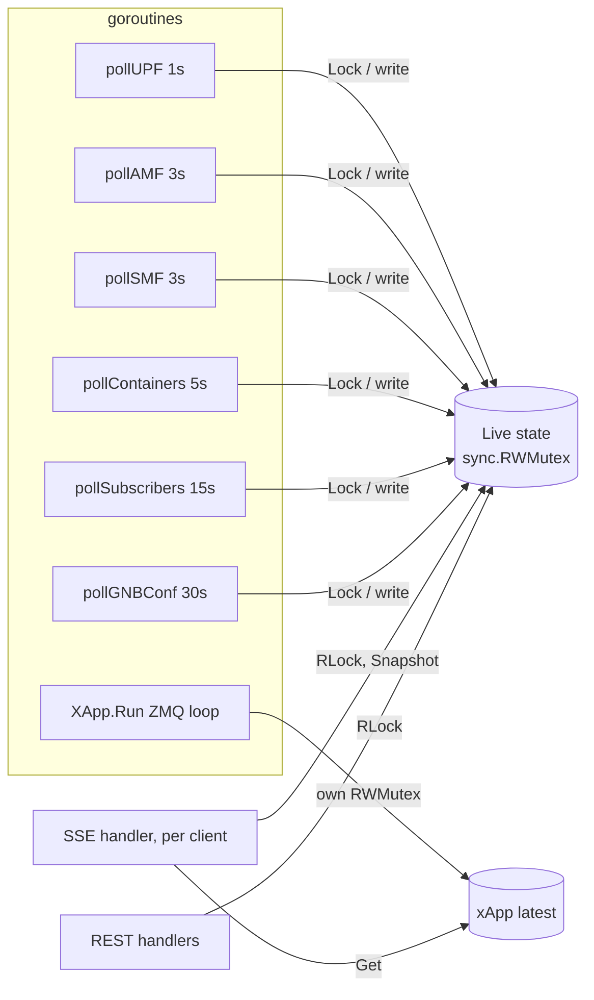

# 5. Backend internals

The backend is a single Go module (`backend/`, module path `github.com/local/5gdashboard`, Go 1.23) with only two external dependencies:

| Dependency | Why |
|------------|-----|
| `github.com/go-zeromq/zmq4` | Pure-Go ZeroMQ, used to subscribe to the xApp without cgo or libzmq |
| `github.com/go-sql-driver/mysql` | MySQL driver for the subscriber DB |

Everything else (HTTP server, routing, JSON, the Docker API client, SSE) is the Go standard library. The binary builds with `CGO_ENABLED=0`, so it's fully static.

---

## 5.1 File-by-file

### `main.go`: wiring and HTTP
- Reads configuration from environment variables into `Config` (see [09 § Configuration](09-deployment.md#94-configuration-reference)).
- **Mode selection:** `MODE=live` or `mock`. `auto` picks live if the Docker socket file exists, otherwise mock.
- Creates the `Source` (`*Live` or `*Mock`) and starts its `Run(ctx)` goroutine.
- Registers routes on a `http.ServeMux`, using Go 1.22+ method-and-pattern routing (`"GET /api/snapshot"`, `"POST /api/nf/{container}/restart"`, `r.PathValue("imsi")`).
- Wraps management routes with `control(...)`, which returns **403** unless `ENABLE_CONTROL=true` *and* the mode is live.
- Serves the SPA: any path that matches a file in `STATIC_DIR` is served as is; everything else gets `index.html`, so client-side routes work on reload.
- Shuts down gracefully on SIGINT/SIGTERM (`signal.NotifyContext`, then `srv.Shutdown` with a 5 s timeout).
- `logReq` logs non-GET requests (management actions) to stdout.

### `model.go`: the data contract
Plain structs with JSON tags: `Snapshot`, `KPIs`, `UE`, `NF`, `GNB`, `GNBConfig`, `TrafficPoint`, `SliceShare`, `Event`, `Subscriber`. These are exactly what the frontend receives (see [06-api.md](06-api.md)).

### `collector.go`: the live source
- `Config`: every tunable.
- `Source` interface:
  ```go
  type Source interface {
      Snapshot() Snapshot
      History(n int) []TrafficPoint
      Subscribers(ctx context.Context) ([]Subscriber, error)
  }
  ```
- `history`: a mutex-protected ring buffer of `TrafficPoint` (max 3600).
- `eventLog`: a mutex-protected ring of 300 `Event`s. `recent(n)` returns newest first.
- `Live`: holds the clients (`dk`, `xapp`, `db`), the latest state of each source, the UPF counter baselines, per-UE and per-slice byte accumulators, and the previous-state maps used for change detection.
- Pollers: `pollContainers`, `pollAMF`, `pollSMF`, `pollUPF`, `pollGNBConf`, `pollSubscribers` (see [03](03-data-collection.md)).
- `apportion()`, `activeIMSIs()`, `observedIMSIs()`.
- `Snapshot()`: the merge logic (see [04](04-correlation.md)).
- `Subscribers()`: DB-backed or observed list.

### `parsers.go`: pure functions, no I/O
`splitTS`, `parseAMF` / `tableRows`, `smfTracker`, `parseNetDev`, `confVal`, `atoi`, `nrarfcnToMHz`, `bwTable`, `parseGNBConf`, `sliceName`. Because they take strings and return structs, they're easy to unit-test against captured logs.

### `docker.go`: Docker Engine API client
A minimal client over the unix socket (see [03 § 1](03-data-collection.md#1-docker-engine-api-nf-health)). The 15 s client timeout bounds every call.

### `xapp.go`: ZeroMQ subscriber
A reconnecting SUB loop that stores the latest report and the two freshness timestamps (see [03 § 6](03-data-collection.md#6-flexric-monitor-xapp-mcs-bler-prbs)).

### `subscribers.go`: MySQL
`List`, `Add` (transactional insert into three tables) and `Delete` (transactional delete), with input validation (see [08](08-management.md)).

### `mock.go`: synthetic source
Produces the same `Snapshot` shape for demos. Details in [§ 5.5](#55-mock-mode).

---

## 5.2 Concurrency model



- **One goroutine per poller**, created by the helper `every(d, f)`, which uses a `time.Ticker`. Each call gets `context.WithTimeout(ctx, 3*d)`.
- The pollers' I/O (Docker calls, MySQL) runs **without holding the lock**. The lock is taken only to swap in the results, so slow I/O never blocks snapshot readers.
- `Live.mu` is a `sync.RWMutex`. Pollers take the write lock for short updates; `Snapshot()` takes the read lock, so many SSE clients can build snapshots at the same time.
- The xApp state has its **own** mutex. `Snapshot()` calls `xapp.Get()` *before* taking `Live.mu`, so the two locks are never nested and can't deadlock.
- `history` and `eventLog` have their own mutexes, so `ev.add()` can be called from anywhere, including while `Live.mu` is held.
- `pollContainers` fans out one goroutine per container for inspect and stats, collecting results under a local mutex and joining them with a `sync.WaitGroup`.
- Shutdown: the root context is cancelled on SIGTERM, every ticker loop exits, and the ZMQ socket is closed through its context.

---

## 5.3 Startup sequence (live)

```
NewLive(cfg)
  ├─ Docker client on DOCKER_SOCK
  ├─ XApp client (if XAPP_ZMQ set) else sources.xapp = "disabled …"
  └─ MySQL pool   (if MYSQL_DSN set) else sources.mysql = "disabled …"
Run(ctx)
  ├─ go xapp.Run(ctx)
  ├─ event "Dashboard collector started"
  ├─ one synchronous pass: containers, AMF, SMF (full history, no events), gNB config, subscribers
  └─ start tickers: UPF 1s, AMF 3s, SMF 3s, containers 5s, gNB config 30s, subscribers 15s
```

The synchronous first pass means the first snapshot a browser receives is already populated (apart from throughput, which needs two UPF samples).

---

## 5.4 Server-Sent Events

`GET /api/stream`:

```go
w.Header().Set("Content-Type", "text/event-stream")
w.Header().Set("Cache-Control", "no-cache")
w.Header().Set("X-Accel-Buffering", "no")   // disable buffering if put behind nginx
for {
    fmt.Fprintf(w, "data: %s\n\n", json(src.Snapshot()))
    flusher.Flush()
    select { case <-r.Context().Done(): return; case <-ticker.C: }   // 1 s
}
```

**Why SSE rather than WebSocket?** The data flows one way only (server → browser). SSE works over plain HTTP, the browser's `EventSource` reconnects automatically, and it needs no extra library on either side. Each client gets an independent stream, and a disconnected client is detected on the next write or by context cancellation.

---

## 5.5 Mock mode

`NewMock` creates 80 subscribers (`00101010000000xx`) and registers 72 of them as UEs spread across two cells and three DNNs (internet, iot, ims). Slices cycle through eMBB, eMBB, URLLC, mMTC, eMBB. It **pre-fills an hour of history**, so charts are full from the first second.

Every second, `step()` does the following:
- DL ≈ 780 Mbps and UL ≈ 220 Mbps, made of slow sine waves plus noise; loss ≈ 0.08% ± noise.
- Packet rate = bytes / average packet size (1200 B DL, 900 B UL).
- Per-UE weights vary smoothly in time (mMTC UEs get 10%); the total is split by these weights.
- MCS (DL 18–26, UL 12–20), BLER and PRBs are synthesised per active UE.

`randomEvent()` fires about once every 6 s: a PDU session, a handover between Cell-1 and Cell-2 (it also changes the UE's cell), an Idle↔Active transition, or a QoS change.

The mock snapshot has `mode: "mock"`, and the UI shows a **"Demo data"** pill. Management actions are always disabled in mock mode.

---

## 5.6 Error handling philosophy

- **Per-source isolation:** a failing source only marks its own `sources[...]` entry. Every other source keeps working, and the snapshot is always served.
- **Last-good-value:** parsers that find nothing (AMF tables, gnb.conf) keep the previous state instead of blanking the UI.
- **Explicit errors to the UI:** errors are human-readable strings shown on the Settings page.
- **HTTP errors:** JSON `{"error": "..."}` with a suitable status code (400 validation, 403 control disabled, 404 unknown NF, 502 upstream failure).

---

## 5.7 Building and testing

```bash
cd backend
go vet ./...
CGO_ENABLED=0 go build -o dashboard .
MODE=mock ./dashboard                       # http://localhost:8080 (API only, unless STATIC_DIR points to a build)
```

There are no unit tests in the repository yet. The parsers in `parsers.go` are pure and are the natural first target: capture a few hundred lines of AMF and SMF logs, a `/proc/net/dev` sample and a `gnb.conf`, and write table-driven tests for `parseAMF`, `smfTracker.feed`, `parseNetDev` and `parseGNBConf`.
