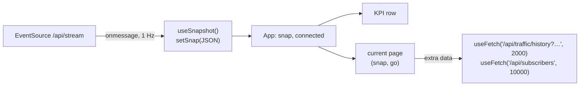

# 7. Frontend internals

A React 18 single-page app built with Vite. Dependencies are deliberately few:

| Package | Use |
|---------|-----|
| `react`, `react-dom` 18.3 | UI |
| `recharts` 2.13 | Area, line, bar and pie charts |
| `lucide-react` | Icons |
| `vite` + `@vitejs/plugin-react` | Dev server and production build |

No router library, no state-management library and no CSS framework. One live snapshot drives the whole UI, so a global store isn't needed.

---

## 7.1 Structure

```
src/
├── main.jsx                 createRoot → <App/>, imports styles.css
├── App.jsx                  layout: sidebar, header, KPI row, tabs, page switch
├── api.js                   useSnapshot (SSE), useFetch (polling REST), api() helper
├── format.js                fmtBytes, fmtRate/rateStr, fmtNum, fmtTime, fmtClock, fmtUptime
├── styles.css               design tokens (:root vars) + every component style + responsive rules
├── components/common.jsx    shared widgets (see § 7.4)
└── pages/
    ├── Overview.jsx         the design.png layout
    ├── Subscribers.jsx      UE table, filters, details panel, subscriber DB, add dialog
    ├── Traffic.jsx          throughput/pps/loss charts with time windows, per-UE bars, slice donut
    ├── Core.jsx             NF cards, inventory table, restart buttons, event log with filter
    ├── Ran.jsx              gNB identity and config, TDD frame, UE radio table, RAN/RIC components
    └── Settings.jsx         data source status, management status, configuration hints
```

---

## 7.2 Live data flow



### `useSnapshot()` (`api.js`)
1. Opens `new EventSource('/api/stream')`. Each message calls `setSnap(JSON.parse(data))` and `connected = true`.
2. On error it closes the stream, sets `connected = false`, **starts polling** `/api/snapshot` every 2 s, and retries SSE after 5 s.
3. When SSE delivers again, polling stops.

This keeps the UI live behind proxies that break streaming, and makes the header show **"Backend Disconnected"** as soon as the backend goes away.

### `useFetch(path, intervalMs, deps)`
A small hook for REST data that isn't in the snapshot: subscribers every 10 s, and traffic history every 2 s when the window changes. It returns `{data, error, reload}`.

### `api(path, opts)`
A `fetch` wrapper that parses JSON and throws `Error(body.error)` on non-2xx. Used for management actions.

---

## 7.3 Layout and routing (`App.jsx`)

- **Hash routing:** `#/overview`, `#/subscribers`, `#/traffic`, `#/core`, `#/ran`, `#/settings`. A small `useHashRoute` hook listens to `hashchange`. Pages are bookmarkable, and the server needs no route config.
- **Sidebar** and **tab bar** both navigate. The sidebar also has Settings.
- **Header:** title, "Real-time network monitoring", a *Demo data* pill in mock mode, the network status pill, a live clock (`useClock`, 1 s) and a reload button.
- **KPI row** (always visible): Registered UEs, Active UEs, DL Throughput (with sparkline), UL Throughput (with sparkline), Total Traffic. Sparklines use the last 60 traffic points and are hidden when all values are 0, so they don't look like underlines.
- Until the first snapshot arrives, a centred loading screen shows *"Connecting to backend…"*.

---

## 7.4 Shared components (`components/common.jsx`)

| Component | Purpose |
|-----------|---------|
| `Card` | Panel with icon, title and right-aligned slot |
| `Dot` | Coloured status dot; class = status (`online`, `Active`, `warning`, …) |
| `KpiCard`, `Sparkline` | KPI tiles |
| `ThroughputChart` | Generic time-series chart (area or line, any series list). X-axis shows `HH:MM:SS` when the span is < 15 min, `HH:MM` otherwise |
| `bucket(data, n)` | Downsamples a series to n buckets by averaging (drops are summed). The overview uses 8 buckets, like the design; Traffic Analytics uses 120 |
| `TrafficSide` | DL / UL / total column next to the overview chart |
| `NFCard` | Core health tile |
| `TowerIcon` | SVG tower, coloured by gNB status |
| `GnbConfigList` | Compact cell parameters list |
| `UETable` | UE table, `basic` (overview) or `full` columns, optional row selection |
| `SliceDonut` | Pie with centre total and legend. Grey ring when there's no traffic |
| `Events` | Recent events card |
| `CityScape` | Decorative SVG skyline from the design (deterministic pseudo-random buildings) |

Charts disable Recharts animations (`isAnimationActive={false}`). With 1 Hz updates, animation would make the lines wobble constantly.

---

## 7.5 Pages

### Overview
A faithful implementation of `design.png`:
- Row 1: **Network Traffic** (8-bucket DL/UL chart with point markers and a side summary) and **5G Core Health** (up to 6 core/DB NF tiles).
- Row 2: **gNB Cells** (tower, status badge, cell parameters), **Connected UEs** (top 5, Active first; a click goes to Subscribers) and **Traffic Distribution** (slice donut).
- Row 3: **Recent Events** (4 newest; "View All" goes to the 5G Core event log) and the skyline.

### Subscribers & UEs
- Stat tiles: provisioned subscribers, registered, Active/Idle split, PDU sessions.
- **UE table** with text search (ID, IMSI, IP, DNN, cell) and a status filter (All / Active / Idle / Deregistered). Clicking a row opens the **details panel**: identity, session, NGAP IDs, C-RNTI, DL/UL rate and volume, MCS, BLER, PRBs, and *stale* and slice badges.
- **Subscriber database** table. When control is enabled and MySQL is configured, it has **Add subscriber** (modal form with client-side validation patterns) and a **delete** button per row (with a confirmation dialog).

### Traffic Analytics
- Stat tiles: DL and UL now/avg/peak over the window, packet rate, UPF loss and drops in the window.
- Time window selector: **1m / 5m / 15m / 1h**. It fetches `/api/traffic/history` every 2 s and downsamples to 120 points.
- Charts: **Throughput** (area), **Packet Rate** (lines), **Packet Loss** (area, with average BLER in the header).
- **Per-UE Throughput**: horizontal stacked bars (DL + UL) for the top 12 UEs.
- **Traffic by Slice** donut and DL/UL volume tiles.

### 5G Core
- Counts: total, online, degraded, offline.
- **Core Health** tiles for the core and DB NFs.
- **NF Inventory**: type, status, health check, uptime, CPU (with a bar, red above 80%), memory, container and image, network addresses, and a **Restart** button when control is enabled (with a confirmation dialog).
- **Event Log**: full list with a level filter.

### RAN & gNB
- A warning banner when the xApp feed isn't `ok`.
- **gNB** card: identity, PLMN, S-NSSAI, AMF/NG addresses, band, SSB frequency, ARFCNs, bandwidth/PRBs, SCS, antennas, SSB power, PRACH index. A selector appears if there are several gNBs.
- **Frame Structure**: rendered TDD slot pattern (D/S/U), period, slot counts, DL ratio, max RX gain, numerology.
- **UE Radio Metrics**: RNTI, MCS DL/UL, BLER DL/UL (green ≤ 3%, orange ≤ 10%, red above), PRBs, and an MCS bar (MCS/28).
- **RAN & RIC Components**: gNB, RIC and xApp containers with CPU and memory.

### Settings
Data-source table (each source with a description and its live status string), management-action status and the list of configuration variables.

---

## 7.6 Styling

All colours and sizes are CSS custom properties in `:root` in `styles.css`. They were sampled from the design:

| Token | Value | Use |
|-------|-------|-----|
| `--bg` | `#0a1120` | Page background |
| `--card` / `--card-2` | `#101b30` / `#142139` | Panels / inner tiles |
| `--border` / `--border-2` | `#1d2b45` / `#263757` | Outlines, table rules |
| `--blue` | `#3b82f6` | Downlink, primary accent, active nav |
| `--purple` | `#8b5cf6` (chart UL `#a855f7`) | Uplink |
| `--green` / `--orange` / `--red` | `#22c55e` / `#f59e0b` / `#ef4444` | Online/Active, Idle/warning, offline/error |

Typography: **Inter** for UI text and **JetBrains Mono** for IDs, IPs and timestamps (Google Fonts).

The UI is dark only, matching the design.

### Responsive behaviour
| Width | Changes |
|-------|---------|
| ≤ 1400 px | KPI row 3 columns; the overview's middle row wraps (UE table goes full width) |
| ≤ 1100 px | All two- and three-column grids stack |
| ≤ 760 px | Sidebar becomes a horizontal icon bar; KPI row 2 columns; the gNB card and donut centre and stack; the subtitle is hidden |

---

## 7.7 Development

```bash
cd frontend
npm install
API_URL=http://localhost:8080 npm run dev     # http://localhost:5173, /api proxied to the backend
npm run build                                 # → dist/ (copied to /app/web in the Docker image)
```

The production bundle is about 635 kB minified (177 kB gzip), mostly Recharts. Code-splitting pages with `React.lazy` would reduce the initial load if that ever matters.
